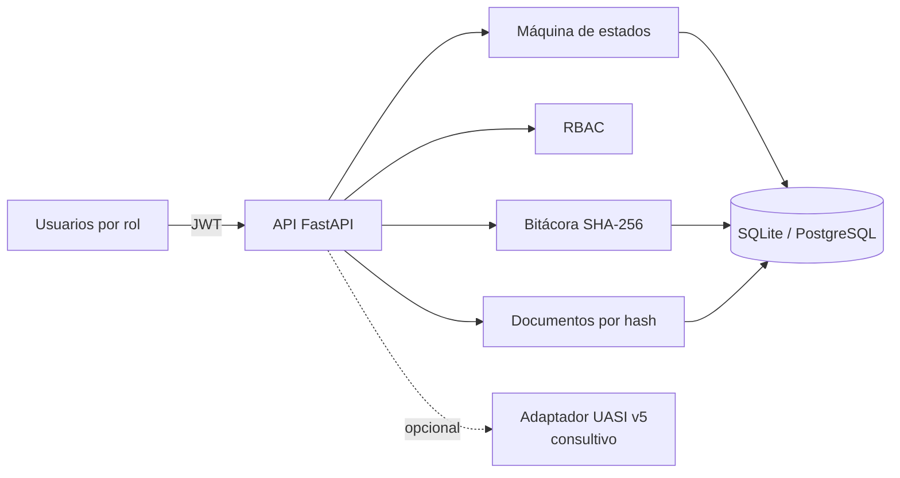

# NGFSystem (NGFS)

**Capa de gestión, trazabilidad y auditoría del ecosistema NESGESFinance · _Tokenización con Propósito_**

> **Estado: prototipo v0.1.** Funcional y probado localmente, pero **no apto para producción** todavía.
> Consulte las limitaciones y la [hoja de ruta](docs/hoja_de_ruta.md) antes de usarlo con datos reales.

NGFS gestiona **expedientes financieros** (proyectos que solicitan financiación o acompañamiento) a lo largo de un
ciclo de vida de **8 etapas**, con:

- **Máquina de estados explícita**: solo se permiten las transiciones definidas; el resto se rechaza.
- **Supervisión humana obligatoria**: aprobar o rechazar exige una persona del Comité, confirmación explícita,
  justificación y segregación de funciones. Nada se decide automáticamente.
- **Control de acceso por roles (RBAC)** con matriz rol × etapa × acción.
- **Autenticación real** con usuario/contraseña (bcrypt) y tokens JWT con expiración y bloqueo por intentos fallidos.
- **Bitácora de auditoría encadenada por SHA-256**, con endpoint de verificación de integridad.
- **Documentos adjuntos registrados por huella SHA-256** y verificables.
- **Adaptador UASI v5 opcional y aislado** (desactivado por defecto): solo aporta análisis consultivo y nunca cambia estados.

## Arquitectura



Stack: Python 3.11+, FastAPI, SQLAlchemy 2.0, Pydantic 2, SQLite por defecto (PostgreSQL vía `DATABASE_URL`),
pytest, ruff, mypy (estricto). Coherente con el repositorio hermano
[UASI v5](https://github.com/NESGESFinance/UASI-v5_repo). Detalles en [docs/arquitectura.md](docs/arquitectura.md).

## Ciclo de vida del expediente

| Etapa | Estado | Responsable |
|---|---|---|
| 1 | Borrador | Solicitante/Promotor |
| 2 | Enviado | Analista |
| 3 | En revisión documental | Analista |
| 4 | En análisis técnico/financiero | Analista |
| 5 | En revisión de cumplimiento | Oficial de Cumplimiento |
| 6 | Aprobado / Rechazado (**decisión humana**) | Comité/Aprobador |
| 7 | En ejecución / seguimiento | Analista, Comité |
| 8 | Cerrado / Archivado | — |

Diagrama y reglas completas: [docs/maquina_estados.md](docs/maquina_estados.md). Matriz de permisos:
[docs/rbac.md](docs/rbac.md). Criterios de aceptación (borrador): [docs/criterios_aceptacion.md](docs/criterios_aceptacion.md).

## Instalación

```bash
git clone https://github.com/NESGESFinance/NGFSystem.git
cd NGFSystem
python3.11 -m venv .venv && source .venv/bin/activate
pip install -e ".[dev]"          # añada ,postgres para usar PostgreSQL
cp .env.example .env             # defina NGFS_JWT_SECRETO
```

### Crear el administrador inicial

```bash
NGFS_ADMIN_PASSWORD='Una-Clave-Larga-2026!' python -m ngfs.cli crear-admin --usuario admin --nombre "Administración"
```

### Base de datos y migraciones

En desarrollo las tablas se crean al arrancar. En producción defina `NGFS_CREAR_TABLAS_AL_INICIAR=false` y aplique
las migraciones Alembic incluidas en el paquete:

```bash
ngfs migrar            # hasta la última revisión
ngfs migrar --sql      # solo muestra el SQL
ngfs migrar --estampar # BD existente creada con create_all → marcarla como migrada
```

### Ejecutar

```bash
uvicorn ngfs.main:app --reload --port 8080
# Documentación interactiva: http://localhost:8080/docs
```

### Con Docker (PostgreSQL)

```bash
cp .env.example .env   # defina NGFS_JWT_SECRETO, POSTGRES_PASSWORD y NGFS_ADMIN_PASSWORD
docker compose up --build
docker compose exec ngfs python -m ngfs.cli crear-admin --usuario admin
```

## Uso rápido

```bash
# 1. Iniciar sesión (devuelve access_token)
curl -s -X POST localhost:8080/auth/login -d "username=admin&password=$NGFS_ADMIN_PASSWORD"

# 2. Crear usuarios por rol (como administrador)
curl -s -X POST localhost:8080/usuarios -H "Authorization: Bearer $TOKEN" -H 'Content-Type: application/json' \
  -d '{"usuario":"promotor1","password":"Clave-Promotor-2026","rol":"solicitante"}'

# 3. Crear un expediente (como solicitante) y enviarlo
curl -s -X POST localhost:8080/expedientes -H "Authorization: Bearer $TOKEN_SOL" -H 'Content-Type: application/json' \
  -d '{"titulo":"Proyecto agrícola sostenible","monto_solicitado":"15000.00","moneda":"USD"}'
curl -s -X POST localhost:8080/expedientes/1/transiciones -H "Authorization: Bearer $TOKEN_SOL" \
  -H 'Content-Type: application/json' -d '{"accion":"enviar"}'

# 4. Decisión del Comité (requiere confirmación humana y justificación)
curl -s -X POST localhost:8080/expedientes/1/transiciones -H "Authorization: Bearer $TOKEN_COMITE" \
  -H 'Content-Type: application/json' \
  -d '{"accion":"aprobar","justificacion":"Cumple criterios técnicos y de cumplimiento.","confirmacion_humana":true}'

# 5. Verificar la integridad de la bitácora (auditor, cumplimiento o administrador)
curl -s localhost:8080/auditoria/verificar -H "Authorization: Bearer $TOKEN_AUDITOR"
```

## Endpoints

| Método | Ruta | Descripción | Roles |
|---|---|---|---|
| GET | `/salud` | Estado del servicio | público |
| POST | `/auth/login` | Inicio de sesión (formulario OAuth2) → JWT | público |
| GET | `/auth/yo` | Usuario autenticado | todos |
| POST | `/auth/logout` | Revoca el token actual | todos |
| POST | `/auth/renovar` | Rota el token (hasta la duración máxima de sesión) | todos |
| POST / GET | `/usuarios` | Alta y listado de usuarios | administrador |
| PATCH | `/usuarios/{id}` | Cambiar rol o activar/desactivar | administrador |
| POST | `/expedientes` | Crear expediente (Borrador) | solicitante |
| GET | `/expedientes` | Listar expedientes visibles (filtro `?estado=`) | todos (según visibilidad) |
| GET / PATCH | `/expedientes/{id}` | Ver / editar (solo en Borrador) | según matriz |
| GET | `/expedientes/{id}/transiciones-disponibles` | Acciones que el usuario puede ejecutar | según matriz |
| POST | `/expedientes/{id}/transiciones` | Ejecutar una transición | según matriz |
| GET | `/expedientes/{id}/historial` | Historial de transiciones | según visibilidad |
| POST / GET | `/expedientes/{id}/documentos` | Registrar (multipart `archivo`) / listar documentos | según matriz |
| POST | `/documentos/{id}/verificar` | Comparar un archivo con la huella registrada | según visibilidad |
| POST / GET | `/expedientes/{id}/analisis-uasi` | Solicitar / listar análisis consultivos UASI | analista, cumplimiento (según etapa) |
| GET | `/auditoria` | Eventos de la bitácora (paginado) | auditor, cumplimiento, administrador |
| GET | `/auditoria/verificar` | Verificación de integridad de la cadena | auditor, cumplimiento, administrador |
| GET | `/meta/estados`, `/meta/rbac` | Definición de la máquina de estados y de la matriz RBAC | todos |

## Calidad

```bash
pytest        # 55 tests (cubren AC-01 a AC-15 y la fase 3); +6 con NGFS_TEST_PG_URL contra PostgreSQL
ruff check .
mypy          # modo estricto sobre src/ngfs
```

**Integración continua:** el workflow está en [`docs/ci.yml.example`](docs/ci.yml.example). Para activarlo, copie el
archivo a `.github/workflows/ci.yml` y súbalo con una cuenta que tenga permiso de *workflows* en GitHub.

## Concurrencia optimista

Cada expediente expone `version`. Envíe `version_esperada` en `PATCH /expedientes/{id}` o en
`POST /expedientes/{id}/transiciones`: si otra persona lo modificó entretanto, la respuesta es `409` y debe volver a
consultarlo. Sin `version_esperada`, el ORM sigue detectando escrituras simultáneas reales (también `409`).

## Limitaciones conocidas (v0.2)

- Los triggers impiden modificar la bitácora con SQL normal, pero un usuario con privilegios DDL (propietario de la
  tabla o superusuario) podría eliminarlos; la verificación lo seguiría **detectando**. En producción, la aplicación
  debe conectarse con un rol sin privilegios DDL. El anclaje externo está planificado (fase 6).
- La limitación de peticiones es en memoria por proceso: con varios workers/réplicas aplíquela también en el proxy.
- No hay interfaz web, decisiones colegiadas ni almacenamiento cifrado de documentos.
- El contrato de API con UASI v5 para análisis de expedientes aún no está definido; el adaptador está listo pero
  desactivado.

## Ecosistema

- Documentación oficial: [NESGESFinance/Documentacion](https://github.com/NESGESFinance/Documentacion)
- [UASI v5](https://github.com/NESGESFinance/UASI-v5_repo) — motor de análisis (aislado, consultivo).
- NGFS **no gestiona tokens** en v0.1. El token NGF·BTC·AM es exclusivamente de utilidad y gobernanza dentro del
  ecosistema y no constituye una oferta ni un instrumento de inversión.

## Licencia

[Apache License 2.0](LICENSE) — elegida por su concesión explícita de patentes y su compatibilidad con uso
institucional. © 2026 NESGESFinance Ecosystem S.A.S. BIC / NESGESFinance Ecosystem S.A.S. LLC. Ver [NOTICE](NOTICE).

Contribuciones: [CONTRIBUTING.md](CONTRIBUTING.md) · Seguridad: [SECURITY.md](SECURITY.md) · Cambios: [CHANGELOG.md](CHANGELOG.md)
